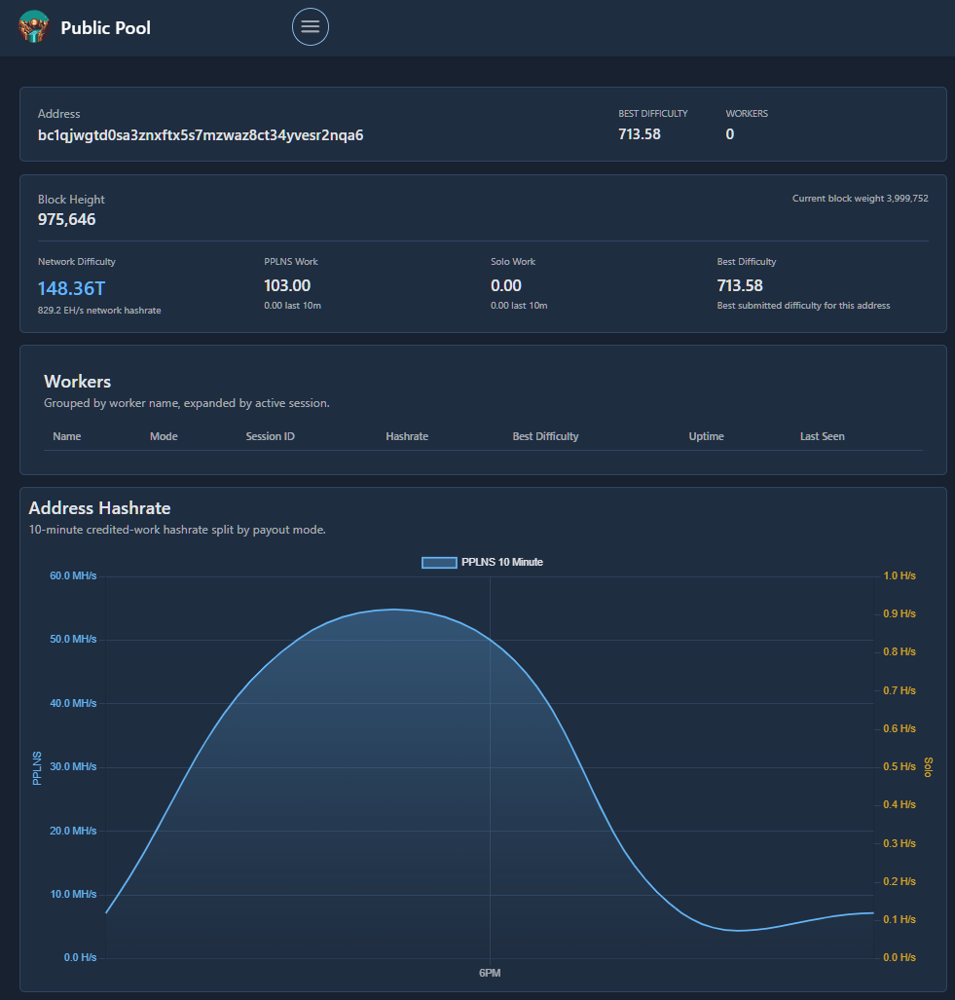
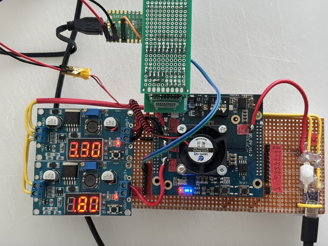
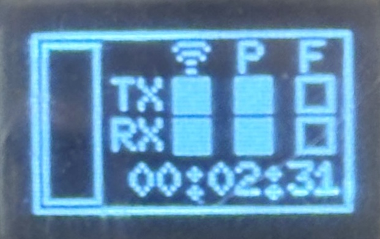
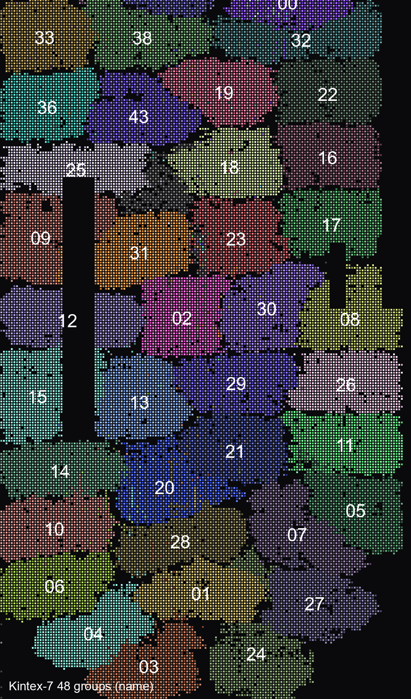

# FPGA Bitcoin Miner

Working project to mine for bitcoin on Tang Nano 9, Tang Nano 20, Kintex7 or Kintext Untrascale+. Optionally supports a microcontroller to bridge to internet. The project was created to learn Verilog and FPGA programming.

# Performance

- Kintext7: 75 MH/s @ 210MHz (41°C) (48 cores)
- Tang Nano 9: 0.4MH/s (2-cores)
- Kintex Ultrascale+: TODO


### Proof of Work

[](https://web.public-pool.io/#/app/bc1qjwgtd0sa3znxftx5s7mzwaz8ct34yvesr2nqa6)




# Hardware

1. FPGA:
  1. Tang Nano 9 or 20 (Tested on 9)
  2. AMD Xilinx FPGA (Tested on Kintex7 & Kintext Untrascale+)
2. Microcontroller (Tested in ESP32-C3 w/ OLED screen)
3. Wiring to connect Microcontroller UART to FPGA
4. JTAG (I used [dirtyJTAG](https://github.com/dirtyjtag/DirtyJTAG))

## Kintex7 Setup




### MCU Miner Screen




# Software

Runs on Windows 11 using git bash. It should be 100% compatible with linux - just chnage the binary locations in the Makefile.

1. [oss-cad-suite 2.1.1](https://github.com/yosyshq/oss-cad-suite-build)
2. [Vivado](https://www.amd.com/en/support/downloads/adaptive-socs-and-fpgas/development-tools/2026-1.html) (if using Xilinx)
3. [Gowin](https://www.gowinsemi.com/en/support/download_eda/) (if using Tang Nano)
4. GNU make
5. PlatformIO (I used [VScode PlatformIO extension](https://platformio.org/install/ide?install=vscode))

# Minig Pool

You can use any pool miner that supports **Stratum V1**. The code connects to `public-pool.io:13333` but that can be changed in [mcu/pool.c](./mcu/pool.c#19).

# Wiring / GPIO

## Microcontroller:

- TX: GPIO 21
- RX: GPIO 20

## FPGA

### Tang Nano

- TX: GPIO 31
- RX: GPIO 32

### Kintext7

- TX: AE21
- RX: AF23

### Kintext UltraScale+

- TX: 
- RX: 

# Notes:

1. The Xilinx has a wrapper top Verilog file called [top_kintext.v](./top_kintext.v) that constructs a 210MHz clock from the 50MHz oscillator
2. You can set the core count in [build_kintex7.tcl](./build_kintex7.tcl)


# Simulator Tests

```
make sim
```

# Building FPGA bitstream

```
make vivado
```

## FPGA Floorplan

The build script makes a floorplan which can be found in the build folder.




or ...

```
make gowin
```

# Flash / Load the Bitstream into FPGA

The code currently 

```
$ make load
OPENFPGALOADER_SOJ_DIR=/c/fpga/oss-cad-suite/share/openFPGALoader /c/fpga/oss-cad-suite/bin/openFPGALoader3 --cable dirtyJtag --fpga-part xc7k325tffg676  build_vivado/pack.bit
Jtag frequency : requested 6000000 Hz -> real 6000000 Hz
Open file build_vivado/pack.bit DONE
Parse file Unknown key SW_HDR_SHA256
DONE
load program
Load SRAM: [==                                                ] 4.00%
...
Load SRAM: [==================================================] 100.00%

Done
Shift IR 35
ir: 1 isc_done 1 isc_ena 0 init 1 done 1
```

or...

```
make flash
```

# Testing & Running FPGA

Ping the FPGA from the host via COM port:

```
$ make ping
python3.14 scripts/ping.py COM6
request:  544e4500000000000000000000000000000000000000000000000000000000000000000000000000000000000000000000000000000000000000000000000000000000000000000000000000000000
response: 4500000000000000000000000000000000000000000000000000000000000000000000000000000000000000000000000000000000000000000000000000000000000000000000000000000000
elapsed:  0.020s
FPGA is alive
```


# Mining!

To mine from the host:

```
make mine

2026-11-13 18:58:39.865 POOL << {"id":27,"error":null,"result":true}
2026-11-13 18:58:47.376 MINER << 4622db05eaa4380cc7fe4610fb1ba881a48cc317a3c12b5f3de13f099696f4866b00000000
2026-11-13 18:58:47.376 MINER << nonce=22db05ea secs=7.92 hashrate=73.817 MH/s share=True share_diff=2.3807573 pool_diff=1 batch_diff=1.5575392
2026-11-13 18:58:47.377 FOUND proof-of-work job=d207104 nonce=22db05ea hash=a4380cc7fe4610fb1ba881a48cc317a3c12b5f3de13f099696f4866b00000000
```
Any proof-of-work and bitcoins found are logged as part of the output.

## MCU Mining

To mine from the MCU - just plug it in.


## Check The FPGA Core Temperature

```
$ make temp
OPENFPGALOADER='OPENFPGALOADER_SOJ_DIR=/c/fpga/oss-cad-suite/share/openFPGALoader /c/fpga/oss-cad-suite/bin/openFPGALoader3' scripts/xadc_temperature.sh --cable dirtyJtag --fpga-part xc7k325tffg676
2026-11-13 17:43:40 TEMP=33.49C (31.86, 33.89) VCC=1.749V (1.732, 1.773)
2026-11-13 17:44:11 TEMP=39.15C (31.86, 39.5) VCC=1.748V (1.731, 1.773)
2026-11-13 17:44:41 TEMP=42.5C (31.86, 42.93) VCC=1.747V (1.731, 1.773)
```

# Building Microcontroller

See [Microcontroller README](./mcu/)

